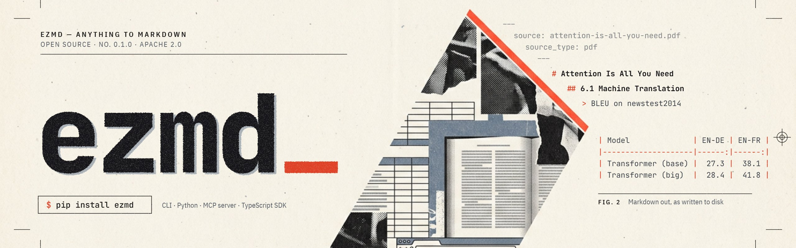

<p align="center"></p>

# ezmd

**Anything in. Clean Markdown out.** ezmd turns PDFs, Office files, web pages, data files, code and
archives into Markdown that AI models read well, keeps a record of where every part came from, and tells
you what it could not convert.

[](https://github.com/larpey/ezmd/actions/workflows/ci.yml)
[](https://pypi.org/project/ezmd/)
[](LICENSE)

<!-- readme: skip (installs from the network) -->
```sh
pip install ezmd                       # Python 3.12 or newer; or: uv tool install ezmd
ezmd convert paper.pdf                 # Markdown on stdout, warnings on stderr
ezmd convert https://example.com -o page.md
```

Apache-2.0. Runs on a CPU with no model downloads. Works as a CLI, a Python library, an MCP server for
Claude, Cursor and other agents, a REST API with a web UI, and a self-hosted Docker stack.

## What you get

Converting the [Mamba paper](https://arxiv.org/abs/2312.00752) (36 pages, CC BY 4.0) with the default
install takes about four seconds and gives one Markdown file:

```markdown
---
title: "Mamba: Linear-Time Sequence Modeling with Selective State Spaces"
source: "mamba.pdf"
source_type: pdf
pages: 36
word_count: 22409
tokens: {o200k_base: 44058, cl100k_base: 44292, claude_approx: 47583}
warnings: [removed_script_or_macro, engine_fallback, removed_running_header_footer, injection_suspected]
---
# Mamba: Linear-Time Sequence Modeling with Selective State Spaces

## 1 Introduction {#sec-1}
...
## 3 Selective State Space Models {#sec-3}
### 3.1 Motivation: Selection as a Means of Compression {#sec-3-1}
```

Every conversion comes with three things:

- **A header of facts.** Title, source, page count, word count, token counts under three tokenizers, a
  content hash, and the list of warning codes. An agent can decide what to do with a document before
  reading it.
- **Structure, kept.** Headings follow the document's own outline, with anchors. Tables stay tables,
  superscripts stay superscripts (`10²⁰`, not `1020`), lists stay lists, links keep their targets. Running
  headers, footers and page numbers are removed; words broken across lines are joined.
- **Warnings, not silence.** Everything ezmd detects it could not convert becomes a warning with a code,
  a count, the pages involved and a suggestion: pages with no text layer, glyphs the PDF's fonts cannot
  map to text, a table that lost its header, content that looks like instructions to an AI. The full list
  is in [docs/warnings.md](docs/warnings.md).

With `--sidecar`, a JSON file beside the Markdown records the page and position of every block, so
answers can cite the page they came from.

## Use it from

### The command line

<!-- readme: run -->
```sh
uv run ezmd convert fixtures/office/docx-review/input.docx --profile compact
uv run ezmd convert fixtures/pdf/born-digital-report/input.pdf --profile rag
uv run ezmd convert fixtures/text/markdown-kitchen-sink/input.md --json
uv run ezmd detect fixtures/pdf/born-digital-report/input.pdf
uv run ezmd batch fixtures/text --recursive --out out/text
```

The commands above run from a source checkout and use files from `fixtures/`, so you can paste them as
they are; installed, drop the `uv run`. Warnings go to stderr as `WARN [code] message`. `ezmd batch`
skips unchanged inputs when run again. URLs are fetched through an SSRF guard that refuses private and
loopback addresses:

<!-- readme: skip (needs network access) -->
```sh
uv run ezmd convert https://example.com --profile compact
```

Every command and option: [docs/cli.md](docs/cli.md).

### Python

<!-- readme: run -->
```python
import ezmd

result = ezmd.convert(
    "fixtures/office/docx-review/input.docx",
    profile="compact",
    on_progress=lambda p: print(p.stage, p.progress),
)
print(result.markdown)
for w in result.warnings:
    print(w.severity, w.kind, w.message)
print(len(result.chunks(chunk_tokens=200)), "rag chunks")  # other profiles render from the same conversion
```

`result.render("rag")` renders another profile without converting again. See [docs/library.md](docs/library.md).

### Claude, Cursor and other agents (MCP)

ezmd is on the MCP registry as `io.github.larpey/ezmd`. Claude Code:

<!-- readme: skip (needs the Claude Code CLI) -->
```sh
claude mcp add ezmd -- uvx ezmd-mcp
```

Claude Desktop (`claude_desktop_config.json`):

```json
{
  "mcpServers": {
    "ezmd": {
      "command": "uvx",
      "args": ["ezmd-mcp", "--allowed-dirs", "/Users/you/Documents"]
    }
  }
}
```

The agent gets tools to convert a URL, a file or pasted text, page through long results, and ask what
this install can convert, with the same warnings. Other clients, the HTTP transport, and running from a
source checkout: [docs/mcp.md](docs/mcp.md).

### REST API and web UI

Run the API in-process (inline queue, no Redis), then convert with `curl`:

<!-- readme: skip (starts a long-running server) -->
```sh
uv run ezmd serve --port 8080
```

<!-- readme: skip (needs the server from the previous block) -->
```sh
curl -s -F file=@fixtures/text/plain-utf8/input.txt -F profile=compact "http://127.0.0.1:8080/v1/convert?wait=30&format=md"
```

The web UI is served at `/` once it is built (needs Node 22 and pnpm):

<!-- readme: skip (installs Node packages from the network) -->
```sh
pnpm install && pnpm --filter @ezmd/web build
```

API reference: [docs/api.md](docs/api.md) and [docs/api/openapi.json](docs/api/openapi.json). The
TypeScript client is `npm install @ezmd/sdk`.

### Your own server (Docker)

The Compose stack (Caddy, API, sandboxed workers, Redis) builds from this checkout:

<!-- readme: skip (needs Docker and builds images) -->
```sh
bash deploy/bootstrap.sh --plain-http --build
```

Then open http://localhost:8080. Signed images for each release are on GHCR (`ghcr.io/larpey/ezmd-api`,
`ezmd-worker`, `ezmd-fetch-node`). TLS, API keys, backups, upgrades and every environment variable:
[docs/selfhost.md](docs/selfhost.md).

## Install

<!-- readme: skip (installs from the network) -->
```sh
pip install ezmd                           # or: uv tool install ezmd
pip install "ezmd[docs]"                   # optional: Docling layout models for PDFs (large, pulls torch)
uvx ezmd-mcp                               # the MCP server
```

On Linux, install CPU torch first or `ezmd[docs]` pulls about 6 GB of CUDA wheels; the Docling extra
downloads its models once. Details and every extra: [docs/install.md](docs/install.md).

From source (needs [uv](https://docs.astral.sh/uv/)):

<!-- readme: skip (clones from the network) -->
```sh
git clone https://github.com/larpey/ezmd && cd ezmd
```

<!-- readme: skip (installs packages; the test environment is already synced) -->
```sh
uv sync --all-packages
uv sync --all-packages --extra docs          # optional: Docling for PDF layout (large, pulls torch)
uv sync --all-packages --extra data          # optional: pyarrow for Parquet
```

Check what this machine can convert (converters, extras, system programs such as LibreOffice):

<!-- readme: run -->
```sh
uv run ezmd capabilities
uv run ezmd doctor
```

## What it converts

| Family | Formats |
|---|---|
| Documents | PDF (text layer by default; Docling layout with the `docs` extra), DOCX, PPTX, XLSX, ODF, RTF, legacy Office (`.doc`, `.xls`, `.ppt`) when LibreOffice is installed |
| Ebooks and notebooks | EPUB, Jupyter notebooks |
| Web | HTML pages and URLs (Trafilatura, rules-based, raw) |
| Data | CSV, TSV, JSON, JSON Lines, YAML, TOML, XML, SQLite, Parquet (`data` extra); database connection strings are refused without echoing credentials |
| Code | Source files; repository archives (zip or tar) packed with a secret scan, with `--converter code.repo_pack` or from a GitHub repository URL |
| Archives | ZIP, TAR, and gzip/bzip2/xz TAR with bomb limits; 7z with the `7z` extra |
| Email | EML, MBOX, Outlook MSG |
| Specialized | SEC EDGAR filings |
| Text | Plain text, Markdown |

The full list, with engines, extras, status, fixture counts and thresholds, is the generated
[converter matrix](docs/converters/README.md).

## Output profiles

One conversion renders in any of four shapes:

- `full`: fidelity first; full frontmatter, numbered headings, page markers, and a JSON sidecar.
- `compact`: for pasting into a chat; minimal frontmatter, link list at the end, a 16,000-token budget.
- `rag`: for indexing; chunk markers with breadcrumbs, and the chunks in the sidecar.
- `agent`: tool output for agents; the body sits inside an untrusted-content fence.

Details: [docs/output-format.md](docs/output-format.md).

## Where it stands

ezmd is at 0.1. What that means in practice:

- **Solid:** web pages, DOCX, XLSX, PPTX, data files, code, archives, email, EPUB.
- **Good and improving:** born-digital PDFs with the default engine. A run over 109 random open-licensed
  arXiv papers (2,553 pages, about 0.1 s per page on a desktop CPU) found and fixed problems with
  titles, heading outlines, superscripts, math letters and table headers; the remaining known gaps are
  figures whose lettering comes out as a table, and display equations, which stay as text.
- **Not yet:** scanned PDFs (OCR is next on the [roadmap](docs/roadmap.md)), audio and video, chat
  exports, social platforms. Local directories are not an input yet; zip the folder, or use `ezmd batch`.

How it compares is measured, not claimed. On 30 whole arXiv papers, with a local model answering the same
148 questions from every converter's output, ezmd, Docling, MinerU and pymupdf4llm all land between 74% and
82% correct, within each other's error bars. Measured against each paper's LaTeX source, a witness no converter
produced, ezmd, MinerU and Docling keep the same share of the words (94 to 95%), so ezmd does not keep more text
than the layout tools. Where they differ: ezmd lost more than 5% of a paper's words without saying so on 0 of 30
papers, against 3 to 5 of 30 for the others; on papers damaged on purpose (scanned pages, truncated files) it
named the unreadable pages exactly and still had one silent loss of its own, a repaired file, now
[issue #23](https://github.com/larpey/ezmd/issues/23). Docling's output is about 20% smaller in tokens than ezmd's
default profile. The numbers, the harness and what ezmd still does badly are in
[docs/benchmarks.md](docs/benchmarks.md).

## Why ezmd

- **Loss is reported.** Every dropped or degraded element ezmd detects becomes a structured warning with
  a code and a suggestion, and the benchmark above measures what still slips through.
- **Provenance.** With the sidecar, every block records its source page and position.
- **Permissive by default.** The default install pulls only allowlisted licenses; anything else is an
  opt-in extra, named as such.
- **One conversion path.** CLI, library, REST API, web UI and MCP server share it, and the Compose stack
  runs on one machine.
- **Hostile input is the default assumption.** Sandboxed workers, an SSRF guard, archive and size limits,
  secrets scrubbed from repository packs, and a flag on content that reads like instructions to an AI.

## Contributing

See [CONTRIBUTING.md](CONTRIBUTING.md) (setup, the council process, the fixture process),
[SECURITY.md](SECURITY.md), and [CODE_OF_CONDUCT.md](CODE_OF_CONDUCT.md). Bug reports with a file that
converts badly are the most useful kind; the fixture process turns them into tests.

## License

Apache-2.0 (see [LICENSE](LICENSE) and [NOTICE](NOTICE)). Optional extras (for example `7z` and
`nonfree`) and some model weights carry their own licenses; they are listed in
[docs/licenses.md](docs/licenses.md).
